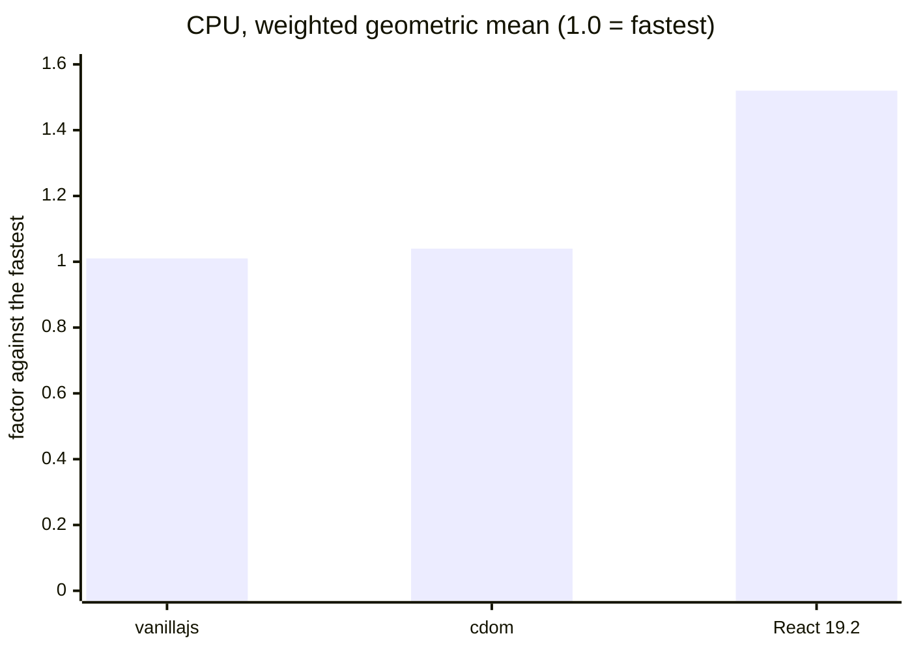
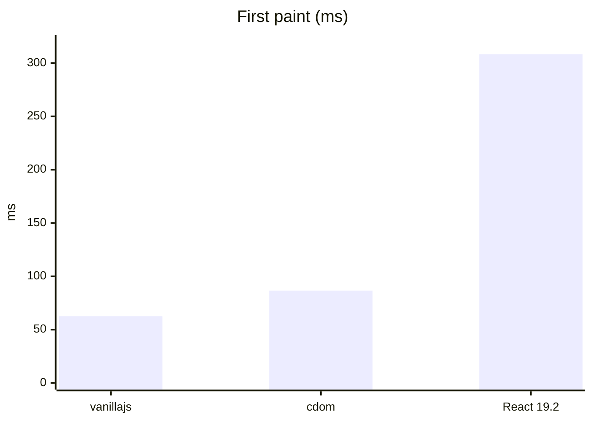
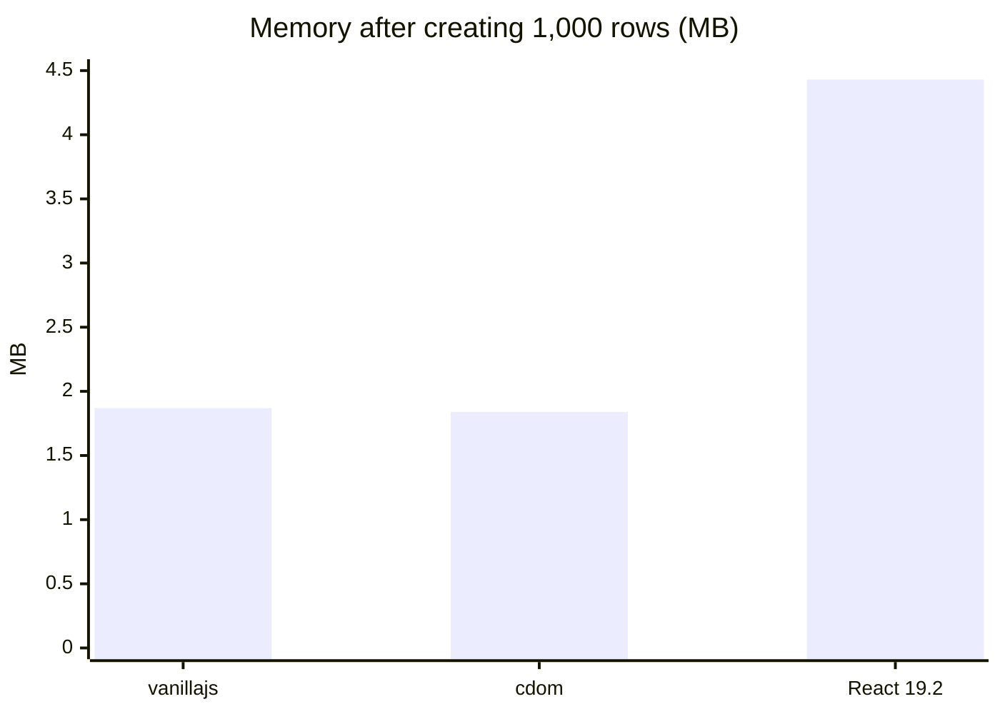
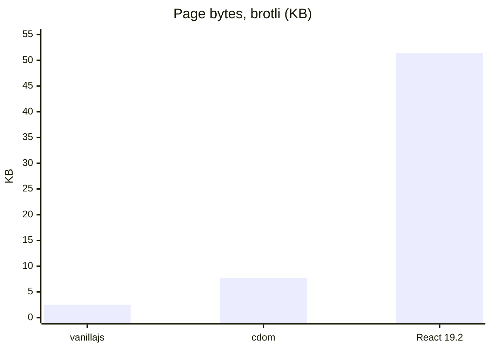
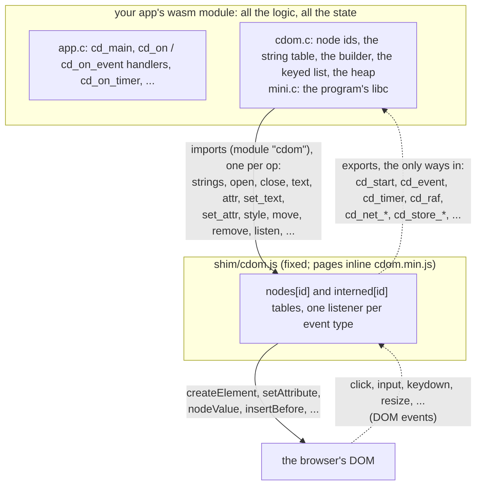
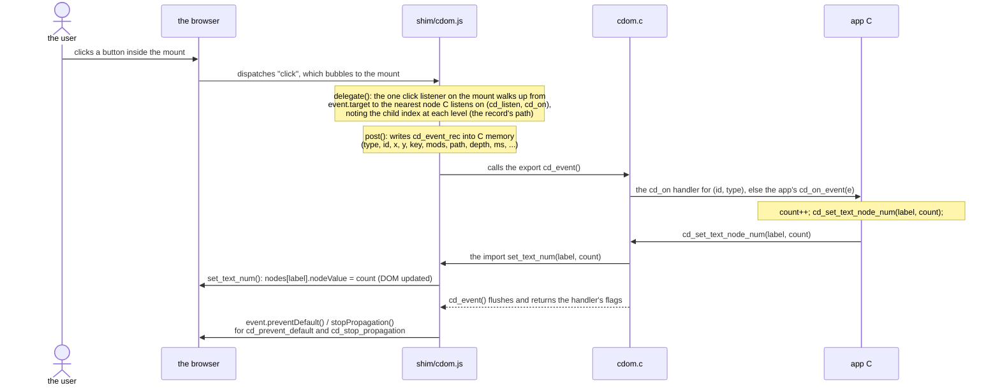
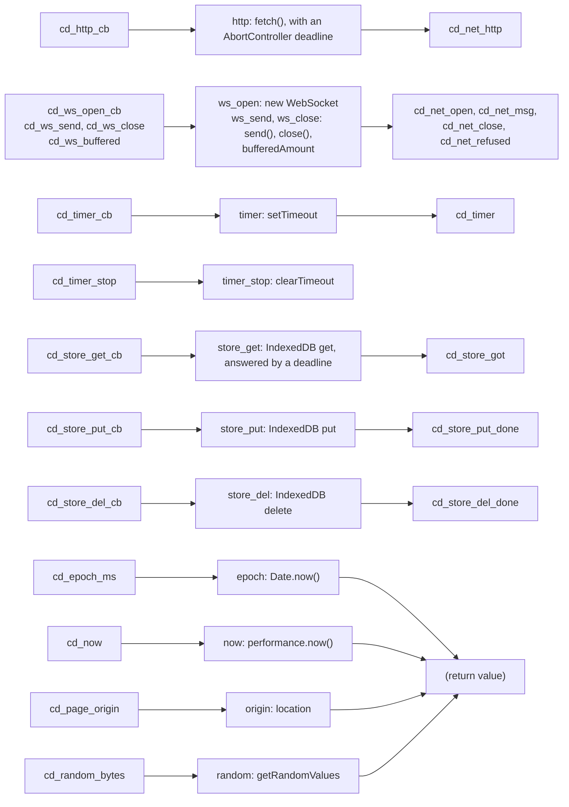
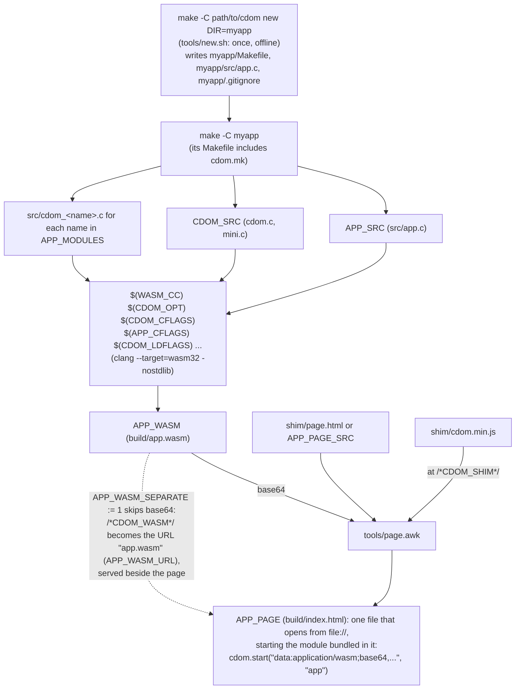

# cdom

cdom is a C library for building web UIs without React.
Your app is C compiled to WebAssembly: it holds the tree, the state and the keyed diff, and a small fixed JavaScript shim makes one DOM call per operation and posts events back.
You get vanilla-JS speed at about a seventh of React's bytes, and the build is make and clang, with no npm, no bundler and no Node.

## Quick start

On macOS, with Homebrew (on Debian or Ubuntu, `apt install clang lld` and set `WASM_CC := clang`, as `make` tells you when it finds no wasm32 clang):

```sh
brew install llvm lld                      # a clang that targets wasm32, and wasm-ld
git clone https://github.com/alexsave/cdom
make -C cdom new DIR=$PWD/myapp            # writes myapp/Makefile, myapp/src/app.c, myapp/.gitignore
make -C myapp                              # builds myapp/build/index.html
open myapp/build/index.html                # one file, opens from disk: it says "cdom" in the middle of the page
```

Edit `myapp/src/app.c` and run `make -C myapp` again.
"Starting an app", below, has the details, and `src/cdom.h` is the API.

## Why cdom

cdom runs as fast as hand-written vanilla JS, and much faster than React, while shipping far fewer bytes.
Every number below comes from [RESULTS.md](RESULTS.md), measured on 2026-10-27 with [krausest/js-framework-benchmark](https://github.com/krausest/js-framework-benchmark) (at ca8715d, keyed, its default puppeteer runner, headless) on an Apple M1 (16 GB), macOS 27.0.1, Chrome 156.
The entries are vanillajs, cdom (its default: interned strings and templates) and react-hooks (React 19.2.0).
Lower is better on every chart.

CPU: the weighted geometric mean of the nine CPU benchmarks (create, replace, update, select, swap, remove and clear rows), each a factor against the fastest entry in the pass, median of 15 runs ([RESULTS.md, "Every operation"](RESULTS.md#every-operation-pass-2-median-of-15), line 54):



Startup: the harness's first paint, median of five runs ([RESULTS.md, "Startup, memory and bytes"](RESULTS.md#startup-memory-and-bytes), line 80):



Memory: the harness's 22_run-memory, `performance.measureUserAgentSpecificMemory()` after creating 1,000 rows, median of five runs ([RESULTS.md, "Startup, memory and bytes"](RESULTS.md#startup-memory-and-bytes), line 93).
That metric does not appear to count wasm linear memory (line 96), so it flatters cdom: cdom starts with 9 pages (576 KB) of linear memory, most of which is never touched.



Size: everything the page downloads (shim, wasm and HTML for cdom), brotli ([RESULTS.md, "Startup, memory and bytes"](RESULTS.md#startup-memory-and-bytes), line 82):



These runs were of cdom's first design, a batched op stream.
cdom now makes one import call per DOM operation, which measured about 1.7% faster on the same weighted geometric mean and 16 ms sooner to first paint, paired against the op stream ([PERF_LOG.md, "The two lines merged"](PERF_LOG.md#the-two-lines-merged-2026-11-08), line 342); the current design has not had a full pass against React of its own.
The shim alone is 14,891 bytes minified and 5,626 brotli ([PERF_LOG.md](PERF_LOG.md), line 421), and the per-operation tables, script times and the other entries (wasm-bindgen, dioxus) are in RESULTS.md.

A hello world against a modern stack, measured on 2026-11-09: the same small app (a page with a name field that greets you through a one-route server) was built once on cdom, with its server also in C, and once on Next.js with create-next-app's defaults.

| | cdom | Next.js |
| --- | ---: | ---: |
| building the page | 0.5 s | about 3 s (the `next build` compile) |
| wall clock, start to a tested, polished app | 11 min 05 s | 6 min 33 s |

The Next.js app installed 363 packages in 28 s (create-next-app 15 s, Playwright and its Chromium 13 s), put 472 MB in the app's `node_modules` and 19 MB at the root, and its page fetched 194,834 bytes over 10 requests.
The cdom app installed no packages: its page builds with make and clang, and is one file with the shim and the module inside it.
The cdom run's wall clock includes writing and mutation-checking its server in C, which the Next.js run's plain Node server did not need, and the time to combine the two starters into one build.

## How it works

The whole page is three layers.
Calls go down, one wasm import per DOM operation, and events come back up as calls into the module's exports.



An interned string crosses once: `strings` copies the new ones into the shim's table before the op that needs them, and every later op names it by id.
The life of one click, with the real names on each side:



An event the browser fires while C is running (`focus()` called from C fires focus events) waits for a microtask, so it never lands in the middle of a handler.

The I/O contract is C calls that the shim fulfils with browser APIs.
An answer comes back as a call into an export, which finds the callback by its token and calls `fn(ctx, ...)`; bytes are copied into room C makes with `cd_bytes_buf`.
The clocks, the origin and random bytes answer at once, as return values.
Each row below reads left to right: the C call (`src/cdom*.h`), the shim import and the browser API it uses, and the export that answers.



- The API is `src/cdom.h`, with the network in `src/cdom_net.h`, the store in `src/cdom_store.h`, and the other platform modules beside them.
- URL helpers are in `src/cdom_url.h` (module `url`): `cd_url_encode` percent-encodes bytes as `encodeURIComponent` does (for a query value), and `cd_url_decode` reverses it; both are plain C, with no shim call.
- A program's libc comes from cdom: `src/libc/string.h`, `src/libc/stdio.h` (`snprintf` and `vsnprintf`, integers and strings, no floats) and `src/mini.c` (add `-isystem cdom/src/libc`).
- The I/O calls external adapters build on (the `_cb` forms, the socket calls, `cd_page_origin`, `cd_random_bytes`, `cd_timer_stop`, `cd_epoch_ms`, `cd_now` and the program's libc) are a stable contract, written at the top of `src/cdom.h`: they change only additively, and `tests/link/contract.c` fails to compile if one changes in place.
- Apps inline `shim/cdom.min.js`, the same shim minified by cdom, so an app needs no JavaScript toolchain.
- A browser without WebAssembly runs the same app through wasm2js on an ES5 shim (see RESULTS.md, "Without WebAssembly", and "Starting an app" below).

## Starting an app

One command makes a new app, with no Node:

```sh
make -C path/to/cdom new DIR=path/to/myapp
make -C path/to/myapp
```

- `make new` (`tools/new.sh`) writes three files into `DIR`, which must be new or empty: a `Makefile` (`CDOM ?=`, `APP_WASM := build/app.wasm`, `APP_SRC := src/app.c`, `APP_PAGE := build/index.html`, the include of `cdom.mk`, and `all: $(APP_PAGE)`), `src/app.c` (about ten lines that put "cdom" in the middle of the page), and a `.gitignore` of `build/`.
- `make` in `DIR` builds `build/index.html`: one file, with the shim and the module inside it, that opens from disk (double-click it; no server).
- Edit `src/app.c` and run `make` again; the page says so at its foot.
- The generator writes nothing `cdom.mk` could own: the page is cdom.mk's default page and every rule is cdom.mk's, so updating cdom updates the app's build.
- `CDOM ?=` defaults to this checkout's absolute path, and `make CDOM=...` or a `CDOM` environment variable overrides it, for another clone, CI or a moved folder: `make new` runs no git, and works offline at any commit.
  To vendor cdom with the app instead (`make new` prints this), run `git init && git submodule add https://github.com/alexsave/cdom cdom` in `DIR` and set `CDOM ?= cdom` (and clone with `--recurse-submodules`).
- Without a clang that targets wasm32 and a `wasm-ld`, `make` stops before compiling and prints the command that installs them (`brew install llvm lld` on macOS).
- `tests/link/run.sh` generates the starter, builds it and opens its page from `file://` in headless Chrome (`tools/starter.mjs`), so the template cannot rot unseen.
- A page that calls a server (`cd_http_cb`, sockets, the store) needs an http origin, not `file://`: serve `build/` from that server instead of opening the file (`make new` says so).

The page starts the app with one call, after the shim, exactly once per page:

```html
<script>
/*CDOM_SHIM*/
cdom.start(/*CDOM_WASM*/, "app");
</script>
```

- `cdom.start(url, mount, env, options)` fetches and instantiates the module, then calls the app's `cd_main` through the module's `cd_start`, and returns a promise of the module's exports.
- `url` is the wasm's URL (a bundled page's `/*CDOM_WASM*/` becomes a `data:application/wasm;base64,` URL, which `fetch` takes from `file://` too, and `instantiateStreaming` still sees as `application/wasm`), or, for a browser without WebAssembly, the wasm2js build of the same module (a function that takes the imports and returns the exports).
- `mount` is the element the app's `CD_MOUNT` is, or its id; given an id that the parser has not reached yet, the wasm loads while the page parses and the app starts once the DOM is ready.
- `env` is an object of the app's own imports, the wasm's `env` module (functions its C declares with `__attribute__((import_module("env"), import_name("...")))`), and may be left out.
- `options.openStore`, when true, opens the store (`src/cdom_store.h`) while the wasm is fetched and compiled, so an app that reads its store as it starts finds it open at its first get.
- `options.seed` fixes `cd_seed` (`src/cdom.h`), the app's one seed for its random draws, so one line makes a run deterministic; without it the seed is 32 bits from `crypto.getRandomValues`, and a page without that fails at start.
- The shim's state (the node table, the memory, the module's exports) is one per page, so a second call would replace the first app's; a page runs one cdom app.
- A page that must run without WebAssembly starts through `shim/boot.js` instead: `cdomBoot(url, mount, env, ready)` calls `cdom.start` itself when WebAssembly exists, and otherwise loads the ES5 shim and the wasm2js build (`url + ".js"`) and starts those; `tools/legacy/build.mjs` makes both, and that build needs Node.
  Both are files beside the page, so a page with this fallback takes `APP_WASM_SEPARATE := 1` (a bundled module has no `url + ".js"` to load).

## Testing an app's page

`tools/cdp.mjs` is a small driver for headless Chrome that an app's own end-to-end test can import (Node, as a test-only tool; the app's build and start need none).

```js
import { launch, sleep } from 'path/to/cdom/tools/cdp.mjs';
const b = await launch();                        // one headless Chrome, its own temp profile, killed by its own PID
await b.send('Page.navigate', { url: 'http://127.0.0.1:PORT/' });
const text = await b.evaluate('document.body.innerText');   // any expression, its value returned
await b.close();                                 // stops Chrome and removes the profile
```

- `launch(args)` starts Chrome on a free debugging port, with `--use-mock-keychain` and `--password-store=basic` (no macOS keychain dialog), and returns `{ send(method, params), evaluate(expr), close(), onEvent }`.
- `send` is any DevTools Protocol command on the page; `onEvent`, when set, hears the page's events (e.g. `Runtime.exceptionThrown`, to fail a test on a page error).
- `tools/starter.mjs` is a complete example: it opens the starter's page, waits for "cdom", and checks it is centered.

## Building an app

An app's Makefile includes `cdom.mk` once, which gives it the one flag set cdom itself builds with, the sources to link, and two rules:

```make
CDOM := path/to/cdom
include $(CDOM)/cdom.mk
APP_WASM := out/app.wasm
APP_SRC := src/app.c
APP_MODULES := net random
APP_CFLAGS := -Wall -Wextra -Werror
APP_LDFLAGS := -Wl,--strip-all
APP_PAGE := out/index.html

build: $(APP_WASM) $(APP_PAGE)
```

From sources to one page, with make, clang, awk and `base64`, and no Node:



- `CDOM_CFLAGS` and `CDOM_LDFLAGS` are the flags every cdom module needs: wasm32 with no C library but cdom's (`src/libc`, `src/mini.c`), bulk memory, no entry point, the memory exported and the stack placed first.
- `CDOM_SRC` is the core every app links, and the APP_WASM rule adds it.
- `APP_MODULES` names the optional modules the app uses (`net`, `store`, `random`, `audio`, `url`, `locale`, `share`, `fonts`, each `src/cdom_<name>.h`), and the rule links them; a name that is not a module stops make.
- Each module's source is also a variable (`CDOM_NET_SRC`, `CDOM_STORE_SRC` and so on) for an app that writes its own rule.
- The APP_WASM rule compiles with `$(CDOM_OPT)` (`-Oz` unless the app sets it), `CDOM_CFLAGS`, `APP_CFLAGS`, `CDOM_LDFLAGS` and `APP_LDFLAGS`; `WASM_CC` is the clang (Homebrew's llvm by default, since Apple's clang has no wasm32 target).
- The include may come before or after the `APP_*` variables are set, so a fragment that needs cdom.mk's variables first (to name `CDOM_CFLAGS` or a module's source in its own) is included after it, and `APP_*` after both.
- The rules read `APP_*` when make builds, not at the include: they are pattern rules (`%.wasm`, `%.html`) that apply only to the files `APP_WASM` and `APP_PAGE` name, so `APP_WASM` ends in `.wasm` and `APP_PAGE` in `.html`.
- They turn on `.SECONDEXPANSION` for the rest of the app's Makefile, so a `$$` in a later rule's prerequisites is expanded twice.
- An unknown `APP_MODULES` name, or a source that is not there, stops make when it builds `APP_WASM`, naming it; cdom.mk never takes the default goal from the app's first rule.
- The APP_PAGE rule writes the page from cdom's default page (`shim/page.html`), or from the app's own, `APP_PAGE_SRC`.
  The default page is a contract, stated in cdom.mk's header: a doctype, the charset and viewport metas, a `<title>` of `APP_TITLE` (the base name of `APP_WASM` unless set), `<div id="app"></div>` as the mount, and one `<script>` that holds the shim and `cdom.start(<the module>, "app")`.
  An app that needs its own `<head>`, `env` or `options` brings its own page.
- The page markers are API: the page has a `<script>` with a line that holds only `/*CDOM_SHIM*/`, which becomes `shim/cdom.min.js`, and `/*CDOM_WASM*/` stands for `cdom.start`'s first argument.
- By default the module is bundled: `/*CDOM_WASM*/` becomes `"data:application/wasm;base64,..."` of `APP_WASM`, so an app is one html file.
  It costs about 30% more bytes after compression (a hello world 9.5 to 12.3 KB brotli, amgi 29.9 to 39.2 KB), and in exchange the page is one request, the page and its module are never from two builds, and it opens from disk (`file://`).
  A bundled page under a Content-Security-Policy needs `data:` in `connect-src`, besides `'wasm-unsafe-eval'`; what needs a real origin (IndexedDB, so the store module, in some browsers) needs the page served over HTTP.
- `APP_WASM_SEPARATE := 1` keeps the module a file of its own, for large apps, hosts that cache a hashed `.wasm`, or the no-WebAssembly fallback: `/*CDOM_WASM*/` becomes its URL, `APP_WASM_URL` (the base name of `APP_WASM`, beside the page, unless set), or the page names it itself (`cdom.start("app.wasm", "app")`).
- Bundling, an app's own page must start the bundled module: a page that names its module by URL fails the build with `this page loads app.wasm; set APP_WASM_SEPARATE := 1, or start with the bundled module (the /*CDOM_WASM*/ marker)`, and cdom never rewrites the app's call.
- The rule fails, and writes nothing, when the page has no `/*CDOM_SHIM*/` line, has two, or has the marker beside other text, or has two `/*CDOM_WASM*/`; `$(call cdom_page,in.html,out.html)` does the same inside an app's own recipe, and `$(call cdom_page,in.html,out.html,module.wasm)` bundles that module too.
- Nothing on this path needs Node: it is make, awk (`tools/page.awk`), `base64` and clang.

## Working on cdom

- Tests: `tests/build.sh`, then `node tools/unit.mjs`, `node tools/fuzz.mjs`, `node tools/canvas.mjs`, `node tools/host.mjs`, `tests/link/run.sh` and `node tools/legacy.mjs`; RESULTS.md, "Reproduce", has the benchmark commands.
- `shim/cdom.min.js` is generated by `node tools/minshim.mjs` and committed, and `tests/build.sh` checks it against `cdom.js`.
- cdom's own builds (`tests/build.sh`, `tests/link/run.sh`, `bench/build.sh`, `micro/svg/run.sh`) read the same flag set as cdom.mk through `tools/cdomflags.sh`, which fails when one of them spells a flag of the set itself.
- cdom and its sibling C library have no cycle: the library may depend on cdom (only its browser adapter does, built against cdom's I/O contract), and cdom never depends on the library.
  `tools/edges.mjs` (run by `tests/link/run.sh`) keeps cdom's side: it fails if a tracked file other than the docs (`*.md`, LICENSE) names the C library it once sat beside.
- Measurements, design notes and how to reproduce them are in RESULTS.md, PERF_LOG.md and BRIDGE.md.

## License

MIT, copyright Alex Saveliev. See LICENSE.
