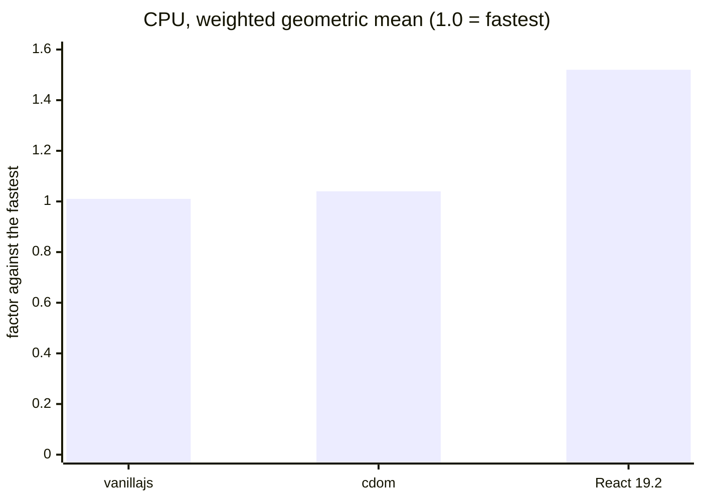
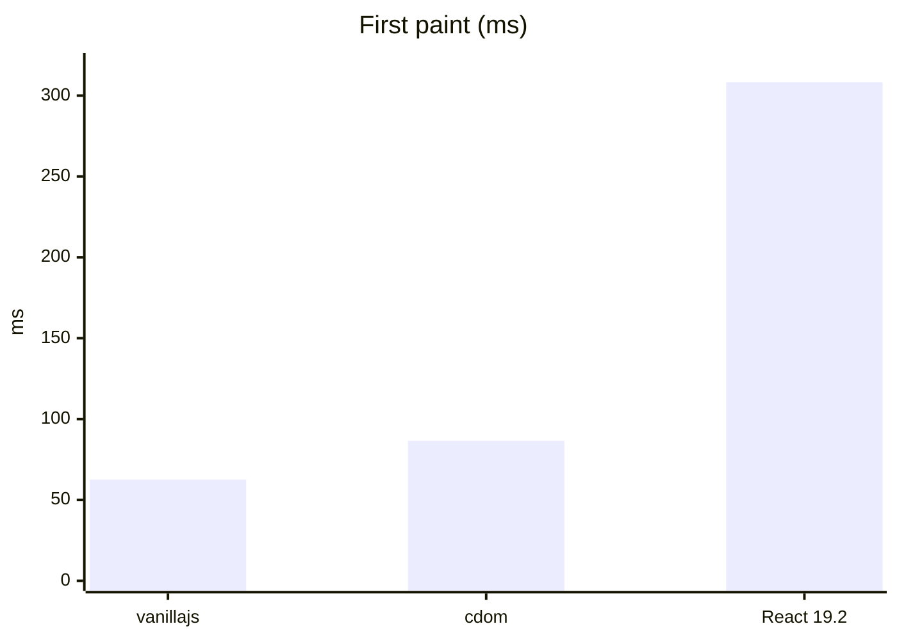
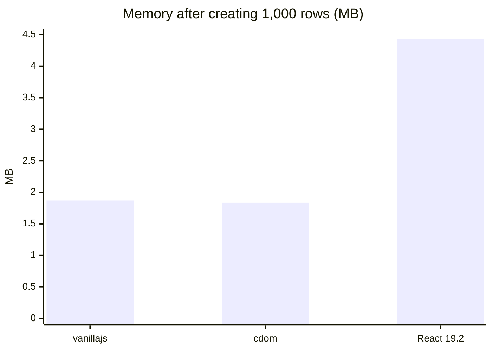
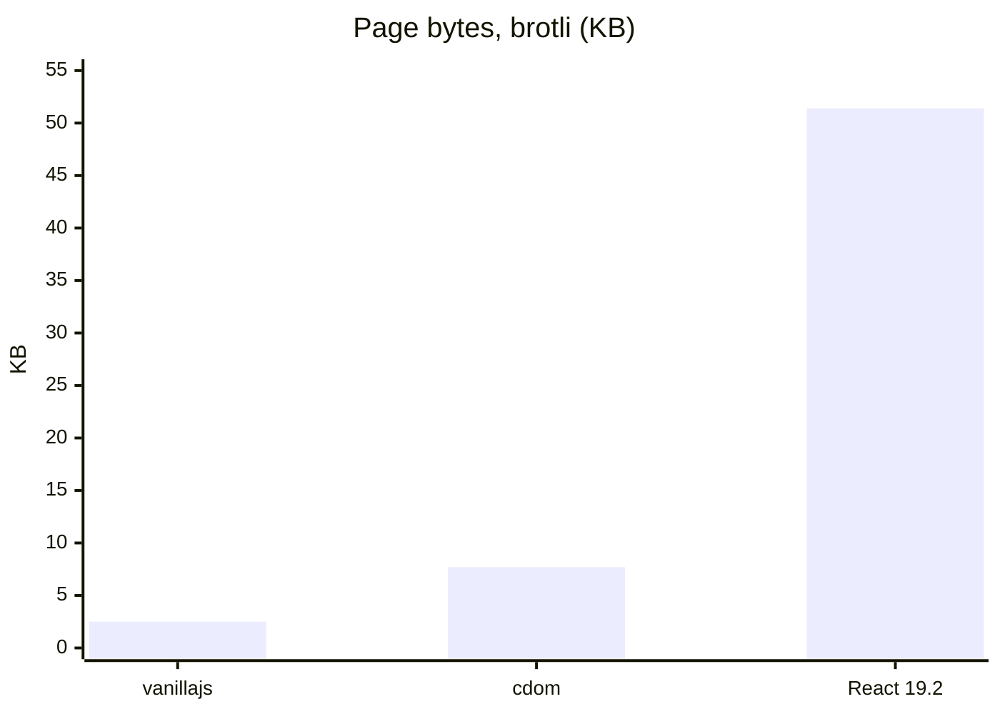
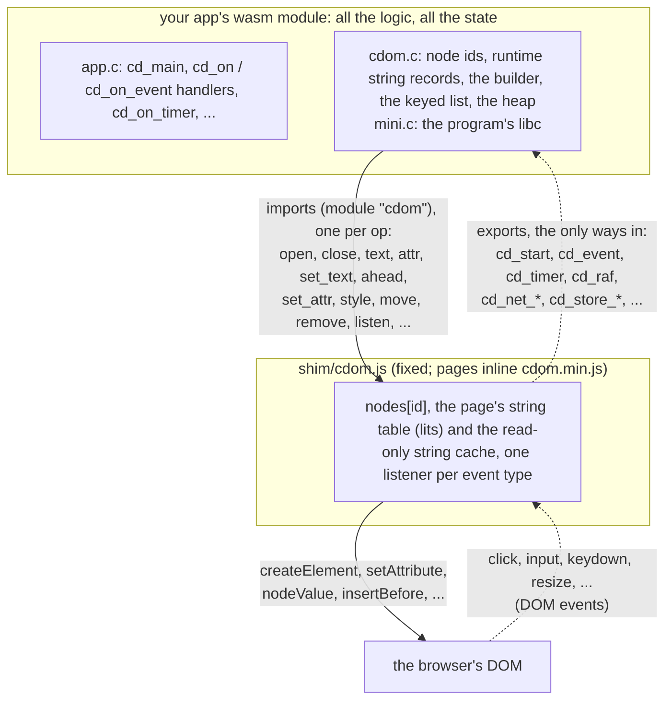
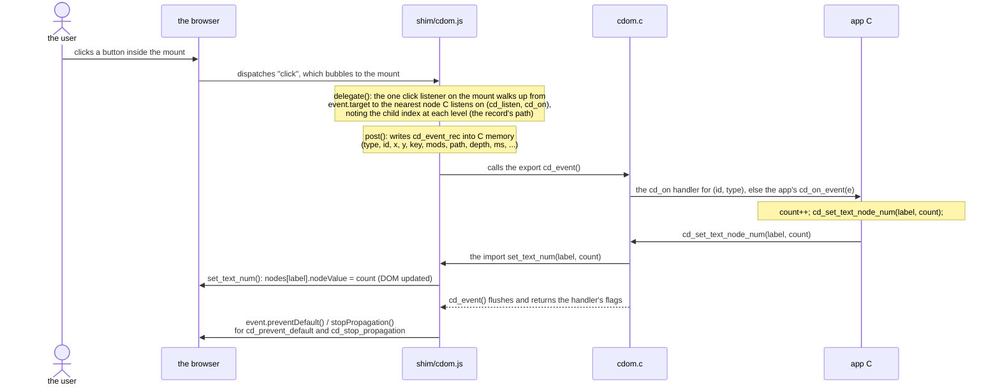
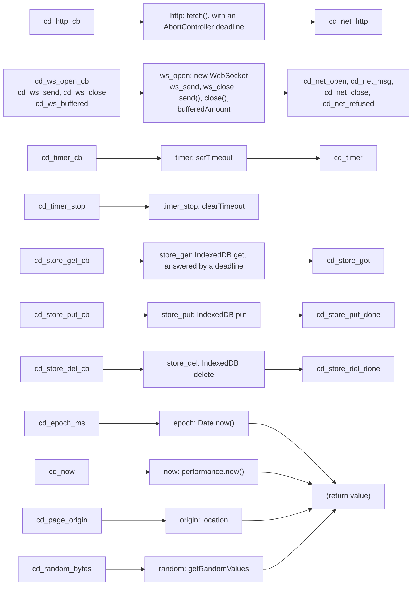
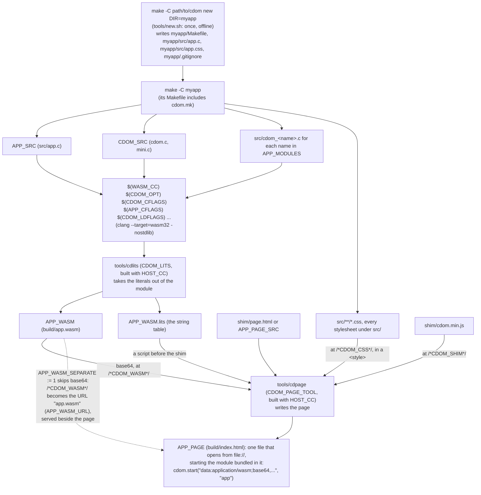

# cdom

cdom is a C library for building web UIs without React.
Your app is C compiled to WebAssembly: it holds the tree, the state and the keyed diff, and a small fixed JavaScript shim makes one DOM call per operation and posts events back.
You get vanilla-JS speed at about a seventh of React's bytes, and the build is make and clang, with no npm, no bundler and no Node.

## Quick start

On macOS, with Homebrew (on Debian or Ubuntu, `apt install clang lld` and set `WASM_CC := clang`, as `make` tells you when it finds no wasm32 clang):

```sh
brew install llvm lld                      # a clang that targets wasm32, and wasm-ld
git clone https://github.com/alexsave/cdom
make -C cdom new DIR=$PWD/myapp            # writes myapp/Makefile, myapp/src/app.c, myapp/src/app.css, myapp/.gitignore
make -C myapp                              # builds myapp/build/index.html
open myapp/build/index.html                # one file, opens from disk: it says "cdom" in the middle of the page
```

Edit `myapp/src/app.c` (the app) or `myapp/src/app.css` (its look) and run `make -C myapp` again.
[`tutorial/`](tutorial/) has seven small apps, each a lesson, with the same app in React beside each one.
"Starting an app", below, has the details, and `src/cdom.h` is the API.

## Why cdom

cdom runs as fast as hand-written vanilla JS, and much faster than React, while shipping far fewer bytes.
The four charts come from [RESULTS.md](RESULTS.md), measured on 2026-10-27 with [krausest/js-framework-benchmark](https://github.com/krausest/js-framework-benchmark) (at ca8715d, keyed, its default puppeteer runner, headless) on an Apple M1 (16 GB), macOS 27.0.1, Chrome 156.
The entries are vanillajs, cdom (its default then: interned strings and templates) and react-hooks (React 19.2.0).
Since 2026-11-17 cdom has no interning: a literal is in the page's string table and any other string is read when it is used ([docs/strings-results.md](docs/strings-results.md)).
Lower is better on every chart.

CPU: the weighted geometric mean of the nine CPU benchmarks (create, replace, update, select, swap, remove and clear rows), each a factor against the fastest entry in the pass, median of 15 runs ([RESULTS.md, "Every operation"](RESULTS.md#every-operation-pass-2-median-of-15), line 54):



Startup: the harness's first paint, median of five runs ([RESULTS.md, "Startup, memory and bytes"](RESULTS.md#startup-memory-and-bytes), line 80):



Memory: the harness's 22_run-memory, `performance.measureUserAgentSpecificMemory()` after creating 1,000 rows, median of five runs ([RESULTS.md, "Startup, memory and bytes"](RESULTS.md#startup-memory-and-bytes), line 93).
That metric does not appear to count wasm linear memory (line 96), so it flatters cdom: cdom starts with 9 pages (576 KB) of linear memory, most of which is never touched.



Size: everything the page downloads (shim, wasm and HTML for cdom), brotli ([RESULTS.md, "Startup, memory and bytes"](RESULTS.md#startup-memory-and-bytes), line 82):



These runs were of cdom's first design, a batched op stream.
cdom now makes one import call per DOM operation, which measured about 1.7% faster on the same weighted geometric mean and 16 ms sooner to first paint, paired against the op stream ([PERF_LOG.md, "The two lines merged"](PERF_LOG.md#the-two-lines-merged-2026-11-08), line 342); the current design has not had a full pass against React of its own.
The shim alone is 17,612 bytes minified and 6,682 brotli on 2026-11-18 (6,672 at the strings change, [docs/strings-results.md](docs/strings-results.md)), and the per-operation tables, script times and the other entries (wasm-bindgen, dioxus) are in RESULTS.md.

A hello world against a modern stack, measured on 2026-11-09: the same small app (a page with a name field that greets you through a one-route server) was built once on cdom, with its server also in C, and once on Next.js with create-next-app's defaults.

| | cdom | Next.js |
| --- | ---: | ---: |
| building the page | 0.5 s | about 3 s (the `next build` compile) |
| wall clock, start to a tested, polished app | 11 min 05 s | 6 min 33 s |

The Next.js app installed 363 packages in 28 s (create-next-app 15 s, Playwright and its Chromium 13 s), put 472 MB in the app's `node_modules` and 19 MB at the root, and its page fetched 194,834 bytes over 10 requests.
The cdom app installed no packages: its page builds with make and clang, and is one file with the shim and the module inside it.
The cdom run's wall clock includes writing and mutation-checking its server in C, which the Next.js run's plain Node server did not need, and the time to combine the two starters into one build.

## How it works

The whole page is three layers.
Calls go down, one wasm import per DOM operation, and events come back up as calls into the module's exports.



A string literal never crosses: the build moves it out of the module into the page's table (`tools/cdlits`, then `tools/cdpage`), and the op passes its slot.
A pointer into read-only data (a ternary, a helper's `const char *`, a `const` table entry) is read from C memory once and kept by address.
Any other string is read from C memory by the op that uses it, and `cd_tmp_ahead` lets an app have a burst of them decoded in one call.
The life of one click, with the real names on each side:



An event the browser fires while C is running (`focus()` called from C fires focus events) waits for a microtask, so it never lands in the middle of a handler.

The I/O contract is C calls that the shim fulfils with browser APIs.
An answer comes back as a call into an export, which finds the callback by its token and calls `fn(ctx, ...)`; bytes are copied into room C makes with `cd_bytes_buf`.
The clocks, the origin and random bytes answer at once, as return values.
Each row below reads left to right: the C call (`src/cdom*.h`), the shim import and the browser API it uses, and the export that answers.



- The API is `src/cdom.h`, with the network in `src/cdom_net.h`, the store in `src/cdom_store.h`, and the other platform modules beside them.
- Shared state: a module keeps its data as plain C, private to its file, with a `cd_state` beside it, and its one setter ends in `cd_changed(&name_state)`.
  A view anywhere in the tree says `cd_watch(&name_state, badge_view, ctx)` while its region builds, and draws itself once; `grep name_state` lists the commit and every view.
  `cd_changed` only bumps the version and queues the state, so a thousand sets in one event cost a thousand increments.
  In the flush that ends the entry each view of a changed state runs once, outermost region first, and a view goes with its region, a pending run included.
  `cd_dirty(fn, ctx)` stays the low-level queue, for a render that is not a view of shared state.
  Built with `-DCD_STATE_CHECK`, a getter's `cd_read(&name_state)` traps when a view, or a region's build, reads a state that nothing there watches.
  `docs/shared-state-design.md` has the design and its measurements.
- Bound values (`cd_bound`) write a node's property only when its value changed; `cd_bind_prop(&b, input, "value")` binds an input's value, and `cd_bound_shows_bytes` records what the user typed, so a view that sets the same bytes back writes nothing and leaves the caret alone.
- A timer slot (`cd_timer_slot`, `cd_timer_set`, `cd_timer_clear`) holds at most one pending timer: setting it again replaces the one that waits (a debounce), and clearing it from a region's cleanup stops it. `cd_input_whole(id, dst, cap, &len)` reads an input's whole value or none of it, with its whole length either way.
- Memory: `cd_alloc` and `cd_realloc`, like `malloc` on cdom's heap, trap when there is no room (in wasm a pointer 0 is ordinary memory, so unchecked code would write over it); `cd_alloc_try` and `cd_realloc_try` answer 0 instead, for code that checks (a large buffer it can do without), and a refused `cd_realloc_try` leaves the block as it was. `-DCDOM_HEAP_PAGES_MAX=N` bounds the heap to N pages of 64 KB.
- URL helpers are in `src/cdom_url.h` (module `url`): `cd_url_encode` percent-encodes bytes as `encodeURIComponent` does (for a query value), and `cd_url_decode` reverses it; both are plain C, with no shim call.
- A program's libc comes from cdom: `src/libc/string.h`, `src/libc/stdio.h` (`snprintf` and `vsnprintf`, integers and strings, no floats, and `FILE` as an incomplete type for headers that name it), `src/libc/stdlib.h` (the heap's `malloc`, `calloc`, `realloc` and `free`, and `abs` and `labs`) and `src/mini.c` (add `-isystem cdom/src/libc`).
- The I/O calls external adapters build on (the `_cb` forms, the socket calls, `cd_page_origin`, `cd_random_bytes`, `cd_timer_stop`, `cd_epoch_ms`, `cd_now` and the program's libc) are a stable contract, written at the top of `src/cdom.h`: they change only additively, and `tests/link/contract.c` fails to compile if one changes in place.
- Apps inline `shim/cdom.min.js`, the same shim minified by cdom, so an app needs no JavaScript toolchain.
- A browser without WebAssembly runs the same app through wasm2js on an ES5 shim, down to IE 9: with typed arrays (IE 10 and 11) on them, and without (IE 9) on C's memory kept in a plain Array of 32-bit words (see RESULTS.md, "Without WebAssembly" and "IE 9, the third tier", and "Starting an app" below).
  The floor is ES5: below it (IE 8) the boot refuses, with one error naming what is missing.

## Starting an app

One command makes a new app, with no Node:

```sh
make -C path/to/cdom new DIR=path/to/myapp
make -C path/to/myapp
```

- `make new` (`tools/new.sh`) writes four files into `DIR`, which must be new or empty: a `Makefile` (`CDOM ?=`, `APP_WASM := build/app.wasm`, `APP_SRC := src/app.c`, `APP_PAGE := build/index.html`, the include of `cdom.mk`, and `all: $(APP_PAGE)`), `src/app.c` (a few lines that put "cdom" in the middle of the page), `src/app.css` (its look, which the build writes into the page's `<head>`), and a `.gitignore` of `build/`.
- `make` in `DIR` builds `build/index.html`: one file, with the shim and the module inside it, that opens from disk (double-click it; no server).
- Edit `src/app.c` or `src/app.css` and run `make` again; the page says so at its foot.
- The generator writes nothing `cdom.mk` could own: the page is cdom.mk's default page and every rule is cdom.mk's, so updating cdom updates the app's build.
- `CDOM ?=` defaults to this checkout's absolute path, and `make CDOM=...` or a `CDOM` environment variable overrides it, for another clone, CI or a moved folder: `make new` runs no git, and works offline at any commit.
  To vendor cdom with the app instead (`make new` prints this), run `git init && git submodule add https://github.com/alexsave/cdom cdom` in `DIR` and set `CDOM ?= cdom` (and clone with `--recurse-submodules`).
- Without a clang that targets wasm32 and a `wasm-ld`, `make` stops before compiling and prints the command that installs them (`brew install llvm lld` on macOS).
- `tests/link/run.sh` generates the starter, builds it and opens its page from `file://` in headless Chrome (`tools/starter.mjs`), so the template cannot rot unseen.
- A page that calls a server (`cd_http_cb`, sockets, the store) needs an http origin, not `file://`: serve `build/` from that server instead of opening the file (`make new` says so).

The page starts the app with one call, after the shim, exactly once per page:

```html
<script>
/*CDOM_SHIM*/
cdom.start(/*CDOM_WASM*/, "app");
</script>
```

- `cdom.start(url, mount, env, options)` fetches and instantiates the module, then calls the app's `cd_main` through the module's `cd_start`, and returns a promise of the module's exports.
- `url` is the wasm's URL (a bundled page's `/*CDOM_WASM*/` becomes a `data:application/wasm;base64,` URL, which `fetch` takes from `file://` too, and `instantiateStreaming` still sees as `application/wasm`), or, for a browser without WebAssembly, the wasm2js build of the same module (a function that takes the imports and returns the exports).
- `mount` is the element the app's `CD_MOUNT` is, or its id; given an id that the parser has not reached yet, the wasm loads while the page parses and the app starts once the DOM is ready.
- `env` is an object of the app's own imports, the wasm's `env` module (functions its C declares with `__attribute__((import_module("env"), import_name("...")))`), and may be left out.
- `options.openStore`, when true, opens the store (`src/cdom_store.h`) while the wasm is fetched and compiled, so an app that reads its store as it starts finds it open at its first get.
- `options.seed` fixes `cd_seed` (`src/cdom.h`), the app's one seed for its random draws, so one line makes a run deterministic; without it the seed is 32 bits from `crypto.getRandomValues`.
  A browser with neither (IE 9 and 10) gets the one exception to the seed rule: `Math.random` mixed with the clock, so below IE 11 `cd_seed` is neither secret nor unpredictable; it is for an app's own draws, never for secrets (`cd_random_bytes` answers UNAVAILABLE there).
- The shim's state (the node table, the memory, the module's exports) is one per page, so a second call would replace the first app's; a page runs one cdom app.
- A page that must run without WebAssembly starts through `shim/boot.js` instead: `cdomBoot(url, mount, env, ready, options)` calls `cdom.start` itself when WebAssembly exists; otherwise, with typed arrays, it loads the ES5 shim (`cdom.legacy.js`) and the wasm2js build (`url + ".js"`), and without them (IE 9) their words twins (`cdom.legacy-ie9.js` and `url + ".ie9.js"`), and starts those.
  `tools/legacy/build.mjs` makes all four (`shim`, `app`, `shim-ie9`, `app-ie9`), and that build needs Node; a browser fetches only its own tier's two.
  They are files beside the page, so a page with this fallback takes `APP_WASM_SEPARATE := 1` (a bundled module has no `url + ".js"` to load).

## Testing an app's page

`tools/cdp.mjs` is a small driver for headless Chrome that an app's own end-to-end test can import (Node, as a test-only tool; the app's build and start need none).

```js
import { launch, sleep } from 'path/to/cdom/tools/cdp.mjs';
const b = await launch();                        // one headless Chrome, its own temp profile, killed by its own PID
await b.send('Page.navigate', { url: 'http://127.0.0.1:PORT/' });
const text = await b.evaluate('document.body.innerText');   // any expression, its value returned
await b.close();                                 // stops Chrome and removes the profile
```

- `launch(args)` starts Chrome on a free debugging port, with `--use-mock-keychain` and `--password-store=basic` (no macOS keychain dialog), and returns `{ send(method, params), evaluate(expr), close(), onEvent }`.
- `send` is any DevTools Protocol command on the page; `onEvent`, when set, hears the page's events (e.g. `Runtime.exceptionThrown`, to fail a test on a page error).
- `tools/starter.mjs` is a complete example: it opens the starter's page, waits for "cdom", and checks it is centered.

## Building an app

An app's Makefile includes `cdom.mk` once, which gives it the one flag set cdom itself builds with, the sources to link, and two rules:

```make
CDOM := path/to/cdom
include $(CDOM)/cdom.mk
APP_WASM := out/app.wasm
APP_SRC := src/app.c
APP_MODULES := net random
APP_CFLAGS := -Wall -Wextra -Werror
APP_LDFLAGS := -Wl,--strip-all
APP_PAGE := out/index.html

build: $(APP_WASM) $(APP_PAGE)
```

From sources to one page, with make, clang and a host C compiler, and no Node:



- `CDOM_CFLAGS` and `CDOM_LDFLAGS` are the flags every cdom module needs: wasm32 with no C library but cdom's (`src/libc`, `src/mini.c`), bulk memory, no entry point, the memory exported and the stack placed first.
- `CDOM_SRC` is the core every app links, and the APP_WASM rule adds it.
- `APP_MODULES` names the optional modules the app uses (`net`, `store`, `random`, `audio`, `url`, `locale`, `share`, `fonts`, `ui`, `file`, `image`, each `src/cdom_<name>.h`), and the rule links them; a name that is not a module stops make.
  A module may be several files, and a module with third-party code compiles it apart, as objects with flags of its own (`-w` and a private `-I`), so an app's `-Wall -Werror` still links it and the app's files never see that code's headers (cdom.mk, `CDOM_<NAME>_PARTS`).
- `file` (`src/cdom_file.h`) brings a picked file's bytes into C memory: `cd_file_read_cb(input, index, max_bytes, fn, ctx)` (or `cd_file_read` with a token, to `cd_on_file`) answers once with a status and the bytes, valid until the callback returns; a file over `max_bytes` is refused from its size and never read.
- `image` (`src/cdom_image.h`) decodes a JPEG or PNG in C and resizes it: `cd_image_resize(p, len, max_w, max_h, &rgba, &w, &h)` answers an RGBA block of the largest size inside the box, the aspect kept, never enlarged, the EXIF orientation applied, which the app frees with `cd_free`; `cd_image_probe` reads only the header.
  A JPEG is decoded row by row at the smallest of libjpeg's scales that is still big enough, a PNG row by row, both into one streaming scaler (an exact area average), so what is held is the file, a few MB and the output, whatever the image's size; a progressive JPEG holds its coefficients too, within a budget (`CD_IMAGE_MEM_MAX`, 96 MiB).
  Every allocation is `cd_alloc_try`, so a full heap is `CD_IMAGE_NO_ROOM`, never a trap; the other statuses are `NOT_IMAGE`, `TOO_BIG`, `UNSUPPORTED`, `CORRUPT` and `BAD_BOX`, and the app says what each means to its user.
  The flow from a file input:

  ```c
  static void got(void *ctx, uint32_t status, const uint8_t *p, uint32_t len) {
    uint8_t *rgba;
    uint32_t w, h;
    if (status != CD_FILE_OK || cd_image_resize(p, len, 1600, 1600, &rgba, &w, &h) != CD_IMAGE_OK) return; /* the app says why */
    cd_encode_image(rgba, w, h, 4, "image/jpeg", 85, ENCODED);   /* answered to cd_on_encoded */
    cd_free(rgba);
  }
  cd_file_read_cb(input, 0, 30000000, got, 0);   /* APP_MODULES += file image */
  ```

  It is libjpeg-turbo 3.2.1's decoder and miniz 3.1.2's inflate (`third_party/`, each directory's README has the version, the archive's sha256, the licence and every edit; `tools/third_party.py check` makes them again from the archives and compares).
  **An app that ships it must say, in its documentation, "This software is based in part on the work of the Independent JPEG Group", and include miniz's MIT notice** (`third_party/miniz-3.1.2/LICENSE`); libjpeg-turbo's BSD notice is asked only of programs that include its TurboJPEG API, which is not here.
  It adds 27.5 KB brotli to an app (JPEG 23.1, PNG 5.0; `bench/image/sizes/run.sh`), and nothing to an app that does not call it.
  libjpeg leaves a fatal error with longjmp; `CDOM_IMAGE_SJLJ` picks how: `js` (the default: a try in the shim, every browser cdom runs in, wasm2js too) or `eh` (wasm exception handling: Chrome 95, Firefox 100, Safari 15.2); docs/image-design.md has both, and the numbers.
  `CDOM_IMAGE_SIMD=1` builds the hot loops (the IDCTs, YCbCr to RGBA, the scaler, the PNG unfilter and RGB to RGBA) with hand-written wasm SIMD: bit-exact with the scalar default, 6% to 13% faster on the bench on an Apple Silicon Mac in Chrome (5% to 14% on an x86 VM), 2.1 KB brotli more, and the module then needs wasm SIMD (Chrome 91, Firefox 89, Safari 16.4); docs/image-simd-hand.md has the profile, the predictions and the numbers.
- `ui` (`src/cdom_ui.h`) is shorthand an app would otherwise write itself: `cd_el`, `cd_el_id` and `cd_el_text`, `cd_button`, the `CD_ON_EVENT`, `CD_CTX_OF` and `CD_CTX_INDEX` macros, and `cd_buf`, a string builder over the caller's buffer with 64-bit numbers. Each call costs only when used.
- `src/cdom_callbacks_only.h`, included after the other cdom headers, makes the token forms and the app-wide hooks a compile error (`#pragma GCC poison`), so an app or a library inside one uses only `cd_on` and the `_cb` forms. It costs no bytes.
- Each module's source is also a variable (`CDOM_NET_SRC`, `CDOM_STORE_SRC` and so on) for an app that writes its own rule.
- The APP_WASM rule compiles with `$(CDOM_OPT)` (`-Oz` unless the app sets it), `CDOM_CFLAGS`, `APP_CFLAGS`, `CDOM_LDFLAGS` and `APP_LDFLAGS`; `WASM_CC` is the clang (Homebrew's llvm by default, since Apple's clang has no wasm32 target).
- The include may come before or after the `APP_*` variables are set, so a fragment that needs cdom.mk's variables first (to name `CDOM_CFLAGS` or a module's source in its own) is included after it, and `APP_*` after both.
- The rules read `APP_*` when make builds, not at the include: they are pattern rules (`%.wasm`, `%.html`) that apply only to the files `APP_WASM` and `APP_PAGE` name, so `APP_WASM` ends in `.wasm` and `APP_PAGE` in `.html`.
- They turn on `.SECONDEXPANSION` for the rest of the app's Makefile, so a `$$` in a later rule's prerequisites is expanded twice.
- An unknown `APP_MODULES` name, or a source that is not there, stops make when it builds `APP_WASM`, naming it; cdom.mk never takes the default goal from the app's first rule.
- The APP_PAGE rule writes the page from cdom's default page (`shim/page.html`), or from the app's own, `APP_PAGE_SRC`.
  The default page is a contract, stated in cdom.mk's header: a doctype, the charset and viewport metas, a `<title>` of `APP_TITLE` (the base name of `APP_WASM` unless set), a `<style>` that holds the app's stylesheets (empty when it has none), `<div id="app"></div>` as the mount, and one `<script>` that holds the shim and `cdom.start(<the module>, "app")`.
  An app that needs its own `<head>`, `env` or `options` brings its own page.
- The page markers are API: the page has a `<script>` with a line that holds only `/*CDOM_SHIM*/`, which becomes `shim/cdom.min.js`, and `/*CDOM_WASM*/` stands for `cdom.start`'s first argument.
  The `<script ...>` tag before `/*CDOM_SHIM*/` must be whole on one line, since the build writes it again after the string table's script.
- Every file whose name ends in `.css` under the app's `src/` directory, in any subfolder, is written into the page's `<style>`, in byte order of its path, so `00-base.css` comes before `10-layout.css`, and that before `theme/dark.css`; a file or folder whose name starts with a dot is skipped, and nothing else is.
  No variable names them, and none turns this off.
  They go at a line that holds only `/*CDOM_CSS*/`, inside a `<style>` and before the `/*CDOM_SHIM*/` line; the default page has that `<style>` in its `<head>`, so an app on it only adds a file.
  An app's own page with no such line fails the build while `src/` holds a `.css` file, so a page that loads a stylesheet of its own with a `<link>` keeps that file outside `src/` (`static/app.css`, say).
  The files are written as they are, but for four things: `</style` is escaped, a comment that fills its lines is left out with them (one beside a rule is kept), a byte order mark is dropped, and a file that does not end in a newline gains one.
  Each file must be whole by itself: a comment, string or `url(` that never ends, a `{` never closed or a `}` never opened, an `@import`, a NUL or bytes that are not UTF-8 stop the build, naming the file and the line.
  A relative `url()` resolves against the page, not the `.css` file, since the sheet is inline.
  The sheet is the page's HTML, before every script, so it styles the first paint in every tier, the IE 9 and 10 fallback too.
  The page is made again when a `.css` file is added, removed, renamed or edited, and for nothing else: `build/index.html.csslist` lists what went in, in order, with a hash of each file.
  Inline styles (`cd_attr("style", ...)`, `cd_set_style`) and a `<style>` built from C still work.
- By default the module is bundled: `/*CDOM_WASM*/` becomes `"data:application/wasm;base64,..."` of `APP_WASM`, so an app is one html file.
  It costs about 30% more bytes after compression (a hello world 9.5 to 12.3 KB brotli, amgi 29.9 to 39.2 KB), and in exchange the page is one request, the page and its module are never from two builds, and it opens from disk (`file://`).
  A bundled page under a Content-Security-Policy needs `data:` in `connect-src`, besides `'wasm-unsafe-eval'`; what needs a real origin (IndexedDB, so the store module, in some browsers) needs the page served over HTTP.
- `APP_WASM_SEPARATE := 1` keeps the module a file of its own, for large apps, hosts that cache a hashed `.wasm`, or the no-WebAssembly fallback: `/*CDOM_WASM*/` becomes its URL, `APP_WASM_URL` (the base name of `APP_WASM`, beside the page, unless set), or the page names it itself (`cdom.start("app.wasm", "app")`).
- Bundling, an app's own page must start the bundled module: a page that names its module by URL fails the build with `this page loads app.wasm; set APP_WASM_SEPARATE := 1, or start with the bundled module (the /*CDOM_WASM*/ marker)`, and cdom never rewrites the app's call.
- The rule fails, and writes nothing, when the page has no `/*CDOM_SHIM*/` line, has two, or has the marker beside other text, or has two `/*CDOM_WASM*/`; `$(call cdom_page,in.html,out.html)` does the same inside an app's own recipe, and `$(call cdom_page,in.html,out.html,module.wasm)` bundles that module too.
- The build needs a host C compiler as well as clang: every link goes through `tools/cdlits` (`CDOM_LITS`, built from `tools/cdlits.c` with `HOST_CC`, `cc` unless set), which takes the string literals out of the module and writes them beside it as `$(APP_WASM).lits`.
- The page gets its string table from `tools/cdpage` (`CDOM_PAGE_TOOL`, built from `tools/cdpage.c` with `HOST_CC`): it writes the `.lits` file as a script of its own before the shim, at the `/*CDOM_SHIM*/` line, so a page needs no marker for it, and `cdom.start` throws on a page with no table or a table from another build.
- Nothing on this path needs Node: it is make, clang and the host compiler (for `tools/cdlits` and `tools/cdpage`).

## Working on cdom

- Tests: `tutorial/run.sh` (builds and drives every lesson), `tests/page/run.sh` (the page tool alone), `tests/lits/run.sh` (the literal tool alone), `tests/build.sh`, then `node tools/unit.mjs`, `node tools/alloc.mjs`, `node tools/fuzz.mjs`, `node tools/canvas.mjs`, `node tools/host.mjs`, `tests/link/run.sh`, `node tools/legacy.mjs` (with `LEGACY=1` and `LEGACY=ie9` for the old tiers) and `node tools/words.mjs`; RESULTS.md, "Reproduce", has the benchmark commands.
- `shim/cdom.min.js` is generated by `node tools/minshim.mjs` and committed, and `tests/build.sh` checks it against `cdom.js`.
- cdom's own builds (`tests/build.sh`, `tests/link/run.sh`, `bench/build.sh`) read the same flag set as cdom.mk through `tools/cdomflags.sh`, which fails when one of them spells a flag of the set itself.
- cdom and its sibling C library have no cycle: the library may depend on cdom (only its browser adapter does, built against cdom's I/O contract), and cdom never depends on the library.
  `tools/edges.mjs` (run by `tests/link/run.sh`) keeps cdom's side: it fails if a tracked file other than the docs (`*.md`, LICENSE) names the C library it once sat beside.
- Measurements, design notes and how to reproduce them are in RESULTS.md, PERF_LOG.md and BRIDGE.md.

## License

MIT, copyright Alex Saveliev. See LICENSE.
